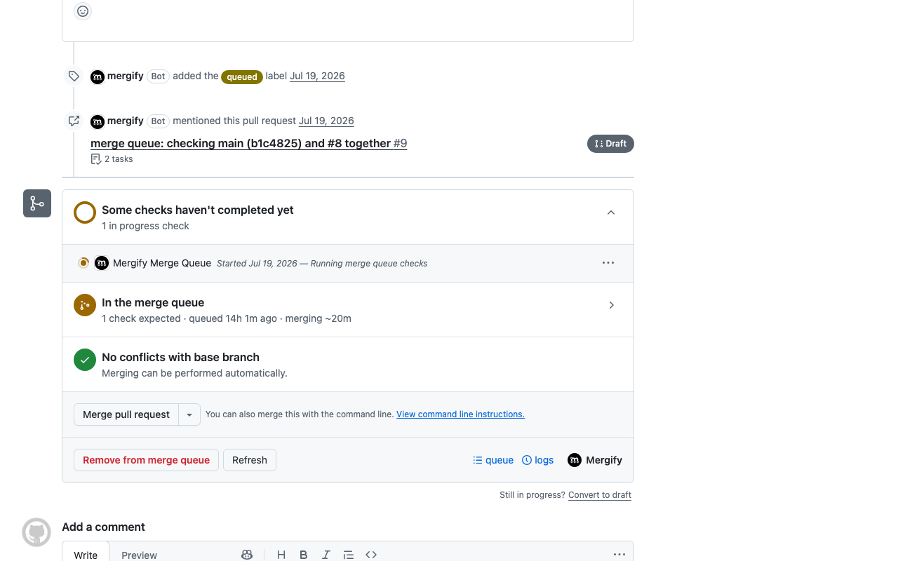

# Mergify Browser extension




## Install

For Chrome, go to [Google Chrome web store](https://chromewebstore.google.com/detail/mergify/idhdcccjlcijifdphaicgnmhifpmilge).
For Firefox, go to [Firefox web store](https://addons.mozilla.org/fr/firefox/addon/mergify/).

## Build

Install the locked dependencies first: `make` uses the esbuild from
`node_modules` and stops if it is missing.
```
$ npm ci
```

To prepare the zip to upload to Google Web Store Developer Dashboard
```
$ make
```


To build the zip for an onpremise installation:
```
$ npm ci
$ make GITHUB_DOMAIN=ghes.company.com MERGIFY_DOMAIN=mergify.company.com
```
